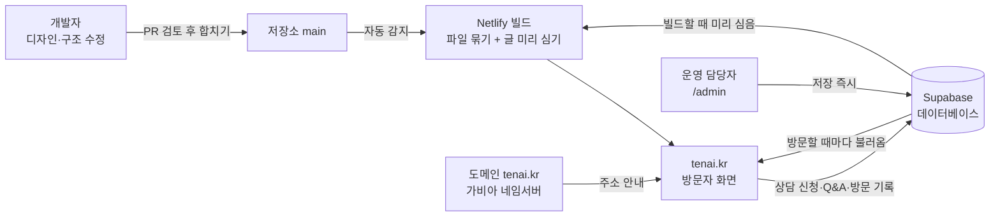

# 회사 홈페이지(tenai.kr) 프로젝트 이해 문서

> 기준일 2026-11-13. 기준 코드는 홈페이지 저장소의 원격 main(마지막 반영 PR #34, 11/12). 실제 사이트 응답은 11/13에 직접 확인했다.
> 읽는 사람: 대표님(비개발자). 이 문서는 온라인 교육 콘텐츠와 "SI 홈페이지 사업" 교재로 바꿀 수 있게 썼다.
> 순서: 업무 지식(2장) → 이 프로젝트가 푸는 문제(3장) → 기능(4·5장) → 기술(6장 이후, 부록).

---

## 1. 한 문장 요약

**tenai.kr은 회사 소개·교육·소식·상담 접수를 한곳에 모은 회사 홈페이지로, 운영 담당자가 관리자 화면에서 글을 바꾸면 바로 반영되고, 디자인을 바꾸면 몇 분 안에 저절로 다시 올라가게 만들어, 외주 업체 없이 작은 팀이 직접 운영할 수 있게 해 준다.**

---

## 2. 먼저 알아야 할 업무 지식

결론: 홈페이지 하나는 "주소(도메인) + 건물(호스팅) + 설계도(저장소) + 입주(배포) + 게시판 관리(관리자 화면) + 규칙 안내문(방침·약관)" 여섯 가지로 굴러가고, 각각 돈·담당자·기한이 따로 있다.

### 2-1. 홈페이지를 건물에 비유하면

| 현실의 가게 | 홈페이지 | tenai.kr의 실제 |
|---|---|---|
| 가게 주소(지번) | 도메인 | tenai.kr |
| 주소를 위치로 바꿔 주는 안내 | DNS(도메인 이름을 실제 서버 위치로 바꾸는 전화번호부) | 등록업체(가비아) 네임서버가 Netlify로 안내 |
| 건물 임대 | 호스팅(사이트 파일을 인터넷에 걸어 두는 곳) | Netlify |
| 설계도와 공사 일지 | 저장소(코드와 바뀐 기록 전체) | 회사 GitHub 조직 계정의 홈페이지 저장소 |
| 인테리어 공사 후 입주 | 빌드·배포(파일을 묶어 실제 사이트에 올림) | main에 합치면 Netlify가 자동으로 |
| 매장 앞 칠판 | 관리자 화면 + 데이터베이스 | /admin + Supabase |
| 매장 이용 규칙, 개인정보 안내문 | 이용약관, 개인정보처리방침 | /terms, /privacy |

### 2-2. 도메인: 사는 법과 연장하는 법

결론: 도메인은 "사는" 것이 아니라 1년 이상 단위로 "빌리는" 것이고, 연장을 놓치면 사이트와 회사 메일이 함께 멈춘다.

- **구매**: 등록대행업체(예: 가비아, 후이즈, 카페24)에서 원하는 이름이 비었는지 검색하고 기간(1~10년)을 골라 결제한다. `.kr`은 한국인터넷진흥원(KISA)이 관리하고, 등록대행업체가 창구다.
- **명의**: 등록자(소유자) 이름이 누구로 되어 있는지가 가장 중요하다. 외주 업체 명의로 사 두면 업체와 관계가 끊겼을 때 회사가 자기 주소를 되찾기 어렵다. 반드시 회사 명의, 회사 공용 메일로 등록한다.
- **연결**: 산 뒤에는 DNS 설정에서 "이 주소로 오면 이 호스팅으로 보내라"를 적는다. 메일을 쓰면 메일 서비스 주소도 여기에 적는다.
- **연장**: 만료일 전에 결제하면 기간이 늘어난다. 자동 연장을 켜 두고, 결제 카드 만료일도 함께 관리한다. 만료일이 지나면 사이트가 열리지 않고, 일정 유예 기간 뒤에는 남이 그 이름을 가져갈 수 있다.
- **tenai.kr 실제 값**(2026-11-13 KISA 조회): 등록일 2025-11-21, **만료일 2027-11-21**, 네임서버는 가비아. 마지막 정보 변경 2026-08-13.

### 2-3. 호스팅: 사이트를 걸어 두는 곳

결론: 호스팅은 "미리 만든 파일만 내보내는 방식(정적)"과 "요청마다 서버가 계산하는 방식(서버형)"이 있고, 회사 소개 사이트는 정적 방식이 싸고 안전하다.

- **정적 호스팅**: 완성된 HTML 파일을 그대로 내준다. 서버를 직접 관리하지 않으므로 보안 패치·장애 대응 부담이 작다. 예: Netlify, Vercel, GitHub Pages.
- **서버형 호스팅**: 게시판·쇼핑몰처럼 요청마다 계산이 필요할 때 쓴다. 예: 웹호스팅 업체의 PHP 서버, 클라우드 서버. 서버 관리자가 필요하다.
- **보안 연결(HTTPS)**: 주소창 자물쇠 표시. 인증서가 필요하며 Netlify는 자동으로 발급·갱신한다.
- **tenai.kr 실제**: 11/13 응답 머리글에 `Server: Netlify`가 찍힌다. 화면은 정적 파일로 내보내고, 자주 바뀌는 내용(소식·강의·Q&A 등)만 Supabase(클라우드 데이터베이스)에서 따로 불러온다. 두 방식의 장점만 섞은 구조다.

### 2-4. 저장소와 배포: 고친 내용이 사이트에 올라가는 길

결론: 요즘 홈페이지는 "파일을 서버에 직접 올리는" 대신 "저장소에 합치면 자동으로 올라가는" 방식으로 운영하고, 그래서 누가 언제 무엇을 바꿨는지 전부 기록으로 남는다.

1. 개발자가 원본(main)을 건드리지 않는 작업 사본(가지, branch)을 만든다.
2. 파일을 고치고 "여기까지 고쳤다"는 기록(커밋)을 남긴다.
3. "이 고침을 원본에 합쳐 달라"는 요청서(PR, Pull Request)를 올린다. 무엇을 왜 바꿨는지 적는다.
4. 검토자가 보고 합친다.
5. 호스팅 서비스가 합쳐진 것을 감지해 자동으로 빌드(파일 묶기)하고 배포(사이트에 올리기)한다.
6. 담당자가 실제 사이트에서 바뀐 것을 눈으로 확인한다.

- **실제 숫자**: 홈페이지 저장소 main 기준 커밋 134건, PR은 #34까지(11/13 확인).
- **실제 사례**: 11/12 "로그인·회원가입·AI 앱 임시 비공개"는 PR #34로 합쳐졌고, 11/13 확인 때 /membership과 /apps 주소는 홈으로 돌아갔다.
- **사고 사례**: 저장소를 개인 계정에서 회사 조직 계정으로 옮긴 뒤(10/19 이후) Netlify와 연결이 끊겨 자동 배포가 멈췄고, 11/10 다시 연결했다. 계정 연결은 눈에 안 보이는 생명줄이다.

### 2-5. 관리자 화면으로 글 바꾸기

결론: 공지·강의 같은 "자주 바뀌는 글"은 개발자 없이 운영 담당자가 관리자 화면에서 바꾸고, 그 글은 데이터베이스에 저장되어 저장 즉시 사이트에 나온다.

- 업계에서는 이것을 CMS(콘텐츠 관리 시스템, 글을 코드 없이 고치는 관리 도구)라고 부른다. 워드프레스, 아임웹, 그누보드가 대표적이다.
- 화면 틀(디자인)은 저장소에, 글은 데이터베이스에 있다. 둘을 나눠 두면 글을 바꿀 때 배포를 기다리지 않고, 디자인을 바꿀 때 글이 날아가지 않는다.
- tenai.kr의 관리자 화면은 /admin이며 10개 메뉴가 있다(4-4절).

### 2-6. 개인정보처리방침과 이용약관이 왜 필요한가

결론: 방침은 법이 공개하라고 정한 "개인정보 사용 설명서"이고, 약관은 회사와 이용자 사이의 "이용 계약서"다. 문의 양식 하나만 있어도 방침은 필요하다.

- **개인정보처리방침**: 「개인정보 보호법」은 개인정보를 다루는 곳이 처리방침을 정해 공개하도록 한다. 무엇을 받는지, 왜 받는지, 얼마나 보관하는지, 누구에게 맡기는지(수탁자), 해외에 저장하는지, 이용자가 무엇을 요구할 수 있는지, 책임자가 누구인지를 적는다.
- **이용약관**: 회원가입·서비스 제공 조건, 금지 행위, 저작권, 책임 범위, 분쟁 해결을 적는다. 회원 기능이 없으면 가볍게, 있으면 꼭 필요하다.
- **바꿀 때**: tenai.kr 방침 9조는 "시행 7일 전 공지, 중대한 변경은 30일 전"이다. 그래서 개정은 "공지일 + 7일 = 시행일"로 계산한다.
- **tenai.kr 실제**: 방침은 2026-09-18 시행, 이후 상담 신청서(10/11), 방문 통계(10/16), 한판 트렌드 소식(11/10) 항목이 차례로 추가되었다. 수탁자 표에는 Supabase, Netlify, Vercel, Google이 있다. 약관은 12개 조이고 "AI 생성 결과에 대한 고지"(제9조)가 들어 있다.

### 2-7. 회원 기능이 붙으면 무엇이 달라지나

결론: 회원 기능은 단추 하나가 아니라 "남의 개인정보를 보관하는 책임"을 지는 일이다. 그래서 tenai.kr은 회원가입을 열기 전과 후의 일이 크게 다르다.

| 구분 | 회원 기능 없음 | 회원 기능 있음 |
|---|---|---|
| 보관하는 정보 | 문의·질문 정도 | 이메일, 비밀번호, 주소·회사·직급 등 |
| 데이터베이스 | 글 저장용 | 계정 저장, "누가 무엇을 볼 수 있나" 규칙 필수 |
| 비밀번호 | 없음 | 복원할 수 없는 형태로 암호화 보관 |
| 방침·약관 | 간단 | 수집 항목·보관 기간·탈퇴·파기 절차 상세 |
| 메일 | 없어도 됨 | 가입 확인 메일 발송, 위조 방지 설정(SPF·DMARC) 필요 |
| 사고 시 | 피해 작음 | 유출을 알면 정해진 기한 안에 이용자 통지와 기관 신고 의무 |
| 운영 업무 | 글 관리 | 계정 문의, 비밀번호 분실, 탈퇴 처리, 권한 부여 |

- **tenai.kr 실제**: 회원가입(이메일, 구글 로그인)은 7월에 만들어 두었지만 11/12부터 임시 비공개다. 권한 규칙은 데이터베이스가 지킨다(RLS, 데이터 한 줄마다 볼 수 있는 사람을 정하는 규칙). 화면을 조작해도 데이터베이스가 거절한다.

### 2-8. 홈페이지 제작 외주(SI) 시장: 고객은 무엇을 사나

결론: 고객이 사는 것은 "페이지 몇 장"이 아니라 "문의가 들어오는 창구, 직원이 직접 고칠 수 있는 관리자, 문제가 생기면 고쳐 줄 사람"이다.

**고객이 실제로 요구하는 것**
- 휴대폰에서도 잘 보이기(반응형), 빠른 로딩
- 직원이 직접 글·사진을 바꿀 수 있는 관리자 화면
- 검색에 잘 걸리기(SEO, 검색엔진 최적화)
- 문의·견적 요청이 메일이나 관리자 화면으로 들어오기
- 개인정보처리방침·약관, 보안(특히 공공·금융 고객)
- 정해진 날짜에 오픈, 견적의 근거
- 오픈 뒤 유지보수(수정 요청, 장애 대응)

**일의 순서(6주짜리 기업 소개 사이트 예)**
1. 상담·사전 질의(1주): 목적, 사용자, 필요한 기능, 자료, 예산, 일정
2. 견적·계약: 포함·제외 범위, 산출물, 일정, 대금 지급 시점
3. 기획(1주): 메뉴 구조(사이트맵), 화면 설계서(스토리보드)
4. 디자인(1~2주): 시안 2~3개 → 고객 선택 → 수정
5. 개발(2주): 화면 만들기, 관리자, 문의 양식, 방침·약관
6. 검수·오픈: 고객 확인 목록대로 점검, 도메인 연결, 오픈
7. 유지보수: 월 단위 계약

**산출물(고객에게 넘기는 것)**: 요구사항 정의서, 화면 설계서, 디자인 원본, 소스와 저장소 권한, 관리자 계정, 운영 매뉴얼, 도메인·호스팅 계정 정보.

**참고 가격**: 우리 SI 사업 데모(4-6절)에 적은 참고 시작가는 홈페이지 표준 150만원(5~8쪽·문의·FAQ), 고급 390만원(10~15쪽·회원·예약·결제 중 1개·다국어), 맞춤 690~1,290만원, 유지관리 월 19만·45만·95만원부터다(VAT 별도). **확정 판매가가 아니라 미확정 참고가**다. 도메인·호스팅·문자·결제 수수료는 별도다.

### 2-9. 등장하는 사람과 주고받는 것

| 역할 | 책임 | 하루에 하는 일 | 주는 것 → 받는 사람 |
|---|---|---|---|
| 발주 고객(우리 홈페이지라면 대표) | 목적·예산·최종 승인 | 시안 확인, 문구 승인 | 회사 자료·로고·결정 → 기획 |
| 기획(PM) | 범위·일정·품질 | 요구사항 정리, 일정 관리, 고객 연락 | 화면 설계서 → 디자이너·개발자 |
| 디자이너 | 보이는 모습 | 시안 제작, 수정 | 디자인 원본 → 개발자 |
| 개발자 | 동작·보안·배포 | 코드 작성, PR, 배포 확인 | 완성 사이트·관리자 계정 → 운영 담당 |
| 운영 담당 | 오픈 뒤 내용 관리 | 소식 올리기, 문의 확인, Q&A 답변 | 수정 요청 → 개발자, 문의 → 영업 |
| 개인정보 보호책임자 | 방침 내용과 이용자 요청 처리 | 열람·삭제 요청 처리 | 방침 문구 승인 → 개발자 |
| 결제·계정 관리(경영지원) | 도메인·호스팅 요금, 계정 명의 | 연장 결제, 카드 관리 | 결제 확인 → 기획 |

작은 회사에서는 한 사람이 여러 역할을 맡는다. tenai.kr도 개발자 한 명이 기획·개발·배포를 맡고, 대표가 발주 고객 겸 승인자다.

### 2-10. 업계 용어 빠르게 보기

| 용어 | 뜻 | 예 |
|---|---|---|
| 사이트맵 | 메뉴 구조도, 또는 검색엔진에 주는 쪽 목록 파일 | tenai.kr은 쪽 10개 + PDF 1개 등록 |
| 시안 | 디자인 후보안 | "단청 회로" 디자인(10/10 적용) |
| 반응형 | 화면 폭에 맞춰 배치가 바뀜 | 퀵메뉴는 1360px 이상에서만 펼침 |
| 검수 | 고객이 약속대로 됐는지 확인 | 확인 목록 대조 |
| 유지보수 | 오픈 뒤 고치기·지키기 | 월 계약 |
| 리다이렉트 | 온 주소를 다른 주소로 보냄 | 숨긴 쪽 → 홈 |

---

## 3. 이 프로젝트가 푸는 문제

결론: 작은 회사 홈페이지의 흔한 손해는 "글 하나 고치는 데 업체 연락과 며칠", "업체가 사라지면 아무도 못 고침", "문의가 어디로 갔는지 모름"이고, tenai.kr은 이것을 직접 제작·관리자 화면·자동 배포로 없앴다.

**외주로만 운영할 때 실제로 생기는 일**
- 교육 일정 하나 바꾸려면 업체에 메일 → 견적 → 며칠 뒤 반영. 그 사이 옛 일정이 노출된다.
- 도메인·호스팅이 업체 명의라 업체와 계약이 끝나면 주소를 옮기기 어렵다.
- 소스가 업체 서버에만 있어 다른 업체에 맡기면 처음부터 다시 만든다.
- 문의는 메일 주소 하나뿐이라 메일 프로그램이 없는 방문자는 그냥 떠난다.
- 방문자가 몇 명인지, 어느 쪽을 많이 보는지 모른다.

**tenai.kr이 바꾼 것**
- 글·강의·핸드북·배너·Q&A는 관리자 화면에서 저장 즉시 반영(배포 대기 없음).
- 디자인 변경은 PR로 합치면 몇 분 안에 자동 배포, 모든 변경이 기록으로 남는다.
- 상담 신청서가 관리자 화면 "상담 신청"에 쌓이고 처리 상태(새 신청·진행 중·끝남)를 관리한다.
- 방문 통계를 개인을 알아볼 수 없는 형태로 직접 모아 관리자 화면에서 본다.
- 이 사이트 자체가 SI 사업의 "우리가 직접 만들고 운영한다"는 실물 사례다.

---

## 4. 기능 전체

결론: 원격 main 기준 페이지 파일 14개, 방문자 기능 42개(공개 34, 숨김 7, 미구현 1), 관리자 기능 11개, 데이터 저장소 12개다. 전체 목록은 부록 A 대조표에 있다.

### 4-1. 페이지 지도

| 주소 | 화면 이름 | 상태 |
|---|---|---|
| `/` | 현관(첫 화면): 회사·학습 두 갈래 | 공개 |
| `/biz` | 회사 홈 | 공개 |
| `/learn` | 학습 홈 | 공개 |
| `/about` | 회사소개 | 공개 |
| `/business` | 사업영역 | 공개 |
| `/education` | 교육 아카데미 | 공개 |
| `/news` | 뉴스 & 홍보 | 공개 |
| `/privacy` | 개인정보처리방침 | 공개 |
| `/terms` | 이용약관 | 공개 |
| `/profile/` | 웹 회사소개서 | 공개 |
| `/apps` | AI 앱 | **숨김**(11/12부터, 주소로 와도 홈으로) |
| `/membership` | 멤버십 & 내 강의실 | **숨김**(11/12부터, 주소로 와도 홈으로) |
| `/admin` | TEN AI 관리자 콘솔 | 관리자만 |
| `/tenai-website.html` | 옛 한 장짜리 소개 페이지 | 열리지만 메뉴 연결 없음 |

### 4-2. 모든 공개 페이지에 공통으로 붙는 기능

| 기능 | 누가·언제 | 넣으면 → 나오는 것 | 좋아지는 점 | 주의할 점 |
|---|---|---|---|---|
| 상단 메뉴·모바일 메뉴 | 방문자, 늘 | 회사 쪽이면 사업영역·교육·소식·회사소개, 학습 쪽이면 학습 메뉴 | 지금 어느 갈래인지 안 헷갈림 | "AI 앱"·"로그인" 단추는 숨김 중 |
| 한/영 전환(KO·EN) | 해외 방문자 | 누르면 화면 글자가 영어 사전으로 바뀜 | 영어판을 따로 안 만들어도 됨 | 관리자가 쓴 글(소식 등)은 사전에 없어 한국어 그대로 |
| 오른쪽 형광 퀵메뉴(QUICK) | 방문자, 늘 | 상담 문의·회사 소개서·사업 영역·교육·소식·회사 소개 바로가기 | 어느 쪽에서든 한 번에 이동 | 좁은 화면에서는 손잡이를 눌러 꺼냄. AI 앱 줄은 숨김 |
| 상담 신청서 | 상담하려는 방문자 | 문의 종류(AI 교육·AX 컨설팅·AIDC 컨설팅·AI 시스템 구축·RUNIQ STUDIO·기타), 이름, 소속, 이메일, 전화, 내용 → 접수 화면 | 메일 프로그램 없이 문의, 관리자 화면에 쌓임 | 쓰던 내용은 그 탭에 잠시 남음. 연 지 3초 안에 보내면 자동 프로그램으로 보고 받은 척만 함 |
| 메일 보낼 방법 고르기 | 메일 링크를 누른 방문자 | Gmail 쓰기 화면·네이버 메일·주소 복사 중 선택 | 웹메일만 쓰는 사람도 막히지 않음 | 네이버는 받는 사람 자동 채움이 안 돼 주소를 복사해 둠 |
| 메일 주소 복사 | 방문자 | 단추 → 주소 복사 안내 | PC에서 바로 붙여넣기 | 복사가 막힌 브라우저는 주소를 선택만 해 둠 |
| 홍보 팝업 배너 | 첫 방문 때 | 관리자가 켠 배너가 팝업으로, 여러 개면 나란히 | 행사·신제품 알리기 | 카드마다 "오늘 하루 보지 않기"와 "닫기" |
| 소식 상세 창 | 소식 카드를 누른 방문자 | 제목·날짜·본문 창 | 페이지 이동 없이 읽음 | 줄바꿈은 그대로 반영 |
| 익명 방문 기록 | 쪽을 열 때 자동 | 본 쪽·들어온 사이트 이름·기기 종류·오늘 첫 방문 여부만 기록 | 어느 쪽이 인기인지 앎 | IP·이름·방문자 번호는 안 남김. "추적 안 함" 설정이면 안 셈. tenai.kr 본 주소만 셈 |
| 갈림길 기억 | 현관에서 회사·학습을 고른 방문자 | 다음 방문부터 고른 쪽으로 바로 | 매번 고르지 않음 | 브라우저에만 저장 |
| 움직임 효과 | 방문자 | 연꽃 애니메이션, 스크롤 등장, 숫자 세기, 흐르는 띠 | 첫인상 | "움직임 줄이기"를 켠 기기에서는 멈춤 |
| 바닥글 | 방문자 | 주소, 슬로건, 방침·약관, 관리자 콘솔 링크 | 법적 고지 접근 | 주소·슬로건은 관리자 설정값 |

### 4-3. 페이지별 기능(공개)

**현관 `/`**
- 서울 AI 허브 멤버십 인증 띠: 2026년 멤버십 기업 표시, 인증서 "크게 보기"(누르면 화면 가득, 원래 크기 전환).
- 오방 배치도 "다섯 방위에 놓은 다섯 가지 일": 가운데 자체 한국어 모델(TenOS-Ko-28B), 둘레에 AI 교육·AX 컨설팅·AI 시스템 구축·AIDC 컨설팅. 목록에 손을 대면 배치도의 같은 방위가 켜진다.
- 단청 이야기 "나무를 지키려고 칠했습니다": 브랜드 설명.
- 학습 입구 "AI를 배우는 시대에서, AI로 배우는 시대로": 바이브코딩·생성형 AI 실무·AI 경영 전략 세 과정으로 들어가는 문.
- 최근 소식 "TEN AI의 요즘": 소식 일부를 요약 카드로.
- RUNIQ STUDIO 소개와 "먼저 써 보기 문의"(상담 신청서가 RUNIQ로 미리 골라져 열림).
- 상담 구역 "보고서로 끝나지 않게,": 상담 신청·메일 문의.

**회사 홈 `/biz`**: 인증 띠, 사업영역 요약("사업영역 8개 전체 보기"), 현장 도구 "현장에서 쓰는 도구를 직접 만듭니다", 최신 소식, 상담 구역.

**학습 홈 `/learn`**: 상단 배지·소개 문구(관리자 "메인 화면 문구"가 실제로 걸리는 유일한 자리), 대표 강의 목록, 신규앱 안내판(숨김), 상담 구역.

**회사소개 `/about`**
- 철학적 기원, AI의 진화 10단계(튜링머신 → 퍼셉트론 → 전문가 시스템 → 딥러닝 → 생성 AI → LLM → 멀티모달 → 에이전트 → 스웜 AI → TEN AI).
- TenOS 순위판: 과학기술정보통신부·NIA의 K-AI 리더보드에서 우리 모델 순위·총점·항목별 점수를 실시간으로 불러온다. 불러오기 실패 시 판을 감춘다.
- 인증서, 회사소개서(웹판 열기, PDF 내려받기: 누르면 화면에 열지 않고 바로 저장).

**사업영역 `/business`**
- 사업영역 8개: AI 교육, AX 컨설팅, AIDC 컨설팅, AI 시스템 구축(SI), AX 플랫폼, AI 강사 양성, AI 리서치·저널, 파트너십 문의.
- 진행 프로젝트 8개: AI ESG 플랫폼, RE100 후보지 입지여건 분석, AIDC 컨설팅, QRAI, PM-AI, GVPTT Project, TenOS, AI 탄소측정 프로젝트.
- 제휴업체·고객사 로고.

**교육 아카데미 `/education`**
- 핸드북 탐색기: 과정 고르기 → 레벨 고르기(1~4) 두 단계, 검색, 카드마다 열람 권한 표시(전체 공개·회원 공개·수강생 전용). 전체 공개 카드는 누르면 연결된 교재로 이동. 주소에 고른 과정이 남아 링크로 공유 가능.
- 대표 강의: 분류 필터, 카드를 누르면 유튜브 새 창.

**뉴스 & 홍보 `/news`**
- 세 창구 현황: 유튜브·핸드북·신규앱 수를 자동으로 센다(11/13 실제 화면: 강의 4편·바로 시청 1편, 핸드북 13권·공개 12권, 신규 공개 7개·전체 18개).
- 소식: 제목·내용 검색, 분류(공지·뉴스·교육) 필터, 상단 고정.
- Q&A "무엇이든 물어보세요": 누구나 이름·이메일(선택)·질문을 남긴다. 관리자가 답하고 "공개"로 돌린 것만 "자주 나온 질문과 답변"에 보인다. 이메일은 공개 화면에 절대 안 나온다.

**방침 `/privacy`, 약관 `/terms`**: 방침 9개 조와 맨 위 개정 안내, 약관 12개 조와 문의. 영어판은 편의 번역이며 한국어가 우선이라고 적혀 있다.

**웹 회사소개서 `/profile/`**: 인쇄본 회사소개서를 웹 문서로(목차, 숫자로 보는 회사, 4대 사업 영역, RUNIQ STUDIO 등). 10/15 게시.

### 4-4. 숨김·미구현 기능

결론: 11/12부터 회원 기능과 AI 앱을 "지우지 않고 가려" 두었다. 다시 열 때 한 번에 되돌릴 수 있다.

| 기능 | 원래 하는 일 | 지금 상태 |
|---|---|---|
| 신규앱 안내판 | 새로 공개한 앱(NEW 표시 또는 공개 30일 이내)을 맨 위에 | 숨김 |
| 앱 검색·쇼케이스 "직접 만든 AI" | 앱 이름·키워드 검색, 분류 필터, 실행·GitHub 링크 | 숨김(/apps 주소는 홈으로) |
| 이메일 회원가입 | 이메일·비밀번호·주소·회사명·직급 | 숨김 |
| 이메일 로그인 | 이메일·비밀번호 | 숨김 |
| 구글 로그인 | 구글 계정으로 가입·로그인 | 숨김 |
| 내 정보·로그아웃 | 내 가입 정보 보기 | 숨김 |
| 회원 공개 핸드북 열람 | 로그인한 회원에게 열림 | 누르면 "회원 전용 핸드북은 준비 중입니다." 안내 |
| 수강생 전용 핸드북 열람 | 과정 등록자에게 열림 | **미구현**: 권한을 주는 기능이 아직 없어 늘 잠김 안내 |

### 4-5. 관리자 콘솔(/admin): 운영 담당자용

결론: 관리자 콘솔은 로그인 1개와 메뉴 10개로, 사이트에서 "글"에 해당하는 것은 전부 여기서 바꾼다. 저장하면 사람이 보는 화면은 즉시 바뀐다.

| 메뉴 | 넣는 것 | 나오는 곳 | 주의할 점 |
|---|---|---|---|
| 로그인·잠금 | 관리자 아이디, 비밀번호 | 콘솔 열림 / "잠금"으로 닫기 | 비밀번호는 메일로 찾을 수 없다. 개발자가 데이터베이스 절차로 다시 정한다 |
| ⚙️ 사이트 설정 | 메인 화면 문구(배지·타이틀 2줄·서브 타이틀), 연락처 & 링크(문의 이메일·유튜브 주소·주소·푸터 슬로건) | 바닥글 주소·슬로건, 메일·유튜브 링크, 학습 홈 배지·소개 | 타이틀 1·2행은 지금 화면에 걸린 자리가 없다. "관리자 암호" 칸은 데이터베이스 연결 시 숨겨진다 |
| ✉️ 상담 신청 | 상태 필터(전체·새 신청·진행 중·끝남), 새로고침 | 신청 목록, 상태 바꾸기, Gmail로 답장, 삭제 | 새 신청 수가 메뉴 옆에 숫자로 뜬다. 1년 지나면 자동 삭제 |
| 📊 접속 통계 | 기간(7·30·90일), 지표(방문자·페이지뷰) | 날짜별 그래프, 많이 본 쪽, 어디서 왔나, 기기 | 10/16부터 쌓임. 합계만 보이고 개인은 안 보인다 |
| 📋 게시물 관리 | 제목, 분류, 내용, 상단 고정 | /news 소식, 현관·회사 홈 최근 소식 | 수정·삭제는 목록에서 |
| 💬 Q&A 관리 | 필터(전체·답변 대기·답변 완료), 분류·답변 | 답변 저장 후 "공개로" 누르면 /news Q&A에 | 답변을 먼저 저장해야 공개할 수 있다 |
| 📚 핸드북 관리 | 제목, 과정, 레벨 1~4, 접근 권한, 소개 문구, 웹 링크, 링크 열기 방식 | /education 핸드북 탐색기, 소식 창구 수 | 링크는 http·https만 열린다 |
| 🎬 강의 관리 | 분류, 재생 시간, 강의 제목, 유튜브 주소, 썸네일 색 2개 | 학습 홈·교육 대표 강의 | 유튜브 주소 또는 영상 ID |
| 🧩 앱 관리 | 앱 이름, 분류, 한 줄 소개, 작동 원리, 검색 키워드, 실행 주소, GitHub 주소, 공개일, NEW 고정 | /apps(숨김 중), 신규앱 안내판(숨김 중) | 등록은 되지만 지금은 방문자에게 안 보인다 |
| 🏷️ 분류 관리 | 영역(게시물·Q&A·핸드북·강의·AI 앱), 새 분류 이름, 배지 색(오렌지·라임·샌드), ▲▼ 순서 | 각 목록의 분류 배지와 필터 | 사용 중인 분류는 "○건 사용 중"으로 표시되고 삭제 시 확인을 한 번 더 받는다 |
| 📣 배너 관리 | 제목, 배지, 본문, 이미지(올리기·주소), 이미지 설명, 버튼 주소·문구, 노출 시작·종료, 정렬 순서, 지금 노출하기 | 공개 페이지 팝업 | 노출 시작을 비우면 바로, 종료를 비우면 계속. "지금 노출하기"를 끄면 저장만 된다 |

### 4-6. 데이터 저장 기능(무엇이 어디에 저장되나)

| 저장소 | 담는 것 | 누가 쓰나 | 누가 읽나 |
|---|---|---|---|
| 사이트 설정 | 문구·연락처 | 관리자 | 누구나(공개 항목만) |
| 게시물 | 소식 | 관리자 | 누구나 |
| Q&A | 질문·답변·이메일 | 누구나 질문, 관리자 답변 | 공개된 질문만 누구나, 이메일은 관리자만 |
| 핸드북 | 교재 목록·권한 | 관리자 | 누구나(목록) |
| 강의 | 강의 목록 | 관리자 | 누구나 |
| 앱 | 앱 목록 | 관리자 | 누구나(화면은 숨김) |
| 분류 | 다섯 영역 분류표 | 관리자 | 누구나 |
| 배너 | 팝업 내용·기간 | 관리자 | 누구나 |
| 배너 이미지 보관함 | 팝업 그림 파일 | 관리자 | 누구나 |
| 상담 신청 | 이름·소속·이메일·전화·내용 | 누구나 보내기만 | 관리자만 |
| 방문 기록 | 익명 집계 | 자동 | 관리자(합계만) |
| 회원 정보 | 이메일·주소·회사·직급·역할 | 본인 | 본인과 관리자 |

### 4-7. 관련 저장소: SI 사업 사전 상담 데모(tenai-si)

결론: 회사 홈페이지와 분리된 SI 사업용 공개 데모로, 고객이 질문 11개에 답하면 추천 제품과 참고 견적이 나온다. 실제 접수·결제·데이터베이스는 연결되지 않았다(11/02 첫 판 이후 변경 없음).

- 질문 11개: 만들고 싶은 변화, 사용자, 제품 종류, 꼭 필요한 기능, 사용 규모·권한, 다른 서비스 연결, 기존·민감 데이터, 초기 예산, 시작 희망일, 준비된 자료, 완성 후 운영.
- 결과: 추천 제품, 가정 개발비 범위(VAT 별도·포함), 계산 내역, 예산 충돌 경고, 별도 비용 목록, 텍스트·JSON 저장, 인쇄.
- 진행 4단계 안내: 사전 질의 → 담당자 검토 → 범위·견적 합의 → 개발·검증·운영.
- "모름"을 고를 수 있고, 연락처는 받지 않으며 답변은 그 브라우저에만 남는다.

---

## 5. 하루 따라가기: 운영 담당자가 새 소식을 올리는 날

결론: 소식 하나를 올리고 확인하는 데 개발자는 필요 없고 15분이면 끝난다. 다만 검색엔진용 사본은 다음 배포 때 바뀐다.

배경 숫자(11/13 실제 사이트): 소식 4건(모두 상단 고정), 핸드북 13권(공개 12권), 강의 4편, 앱 18개. 아래 새 글 제목과 배너는 설명용 예시다.

1. **09:00 로그인**: 브라우저에서 tenai.kr/admin을 연다. 관리자 아이디와 비밀번호를 넣고 "접속하기". 위쪽에 메뉴 10개가 보인다.
2. **09:05 상담 신청 확인**: "✉️ 상담 신청" 옆 숫자를 본다. 어제 들어온 "AI 교육" 문의 1건을 열어 내용을 읽고 "Gmail로 답장"으로 회신한 뒤 상태를 "진행 중"으로 바꾼다.
3. **09:15 소식 쓰기**: "📋 게시물 관리"에서 제목 "12월 생성형 AI 실무 교육 일정 안내", 분류 "교육", 내용 3줄(날짜·장소·신청 방법)을 넣는다. 맨 위에 보여야 하므로 "상단 고정"을 켜고 "💾 게시물 저장".
4. **09:17 사이트에서 확인**: 새 탭에서 tenai.kr/news를 연다. 소식 목록 맨 위에 새 글이 있는지, 분류 배지가 "교육"인지, 카드를 눌러 본문 줄바꿈이 맞는지 본다. 고정 글이 5건이 되었다.
5. **09:20 다른 자리 확인**: 현관(/)의 "TEN AI의 요즘"과 회사 홈의 "최신 소식"에도 새 글이 보이는지 본다. 휴대폰으로도 한 번 연다.
6. **09:22 영어 화면 확인**: EN을 누르면 메뉴는 영어로 바뀌지만 새 글 본문은 한국어로 남는다. 해외 방문자용 공지라면 영어 문장을 본문에 함께 쓴다.
7. **10:00 팝업 배너 걸기**: "📣 배너 관리"에서 제목 "12월 교육 모집", 이미지 올리기, 버튼 주소 tenai.kr/news, 노출 종료를 12월 첫 주로 넣고 "지금 노출하기"를 켠 뒤 저장. 사이트를 새로 열어 팝업이 뜨는지, "오늘 하루 보지 않기"가 되는지 본다.
8. **14:00 Q&A 답변**: "💬 Q&A 관리"에서 "답변 대기"를 눌러 질문을 고른다. 답을 쓰고 "분류 · 답변 저장" → "공개로". /news Q&A에 질문과 답이 보이는지 본다.
9. **17:00 접속 통계**: "📊 접속 통계"에서 7일을 고르고 "많이 본 쪽"에서 /news가 올라왔는지, "어디서 왔나"에서 어느 사이트로 들어왔는지 본다.
10. **17:10 마무리**: 다음 배포 뒤 검색엔진용 사본에도 새 글이 들어간다는 점을 기억한다. 급하게 검색 노출이 필요하면 개발자에게 다시 배포를 부탁한다. 콘솔은 "잠금"으로 닫는다.

막히면: 저장했는데 사이트에 안 보이면 ① 새로고침 ② 다른 브라우저 ③ 그래도 없으면 개발자에게 "관리자 저장은 됐는데 화면에 없음"과 시각을 알린다.

---

## 6. 어떻게 돌아가나

결론: 길은 두 갈래다. 디자인은 "저장소 → 자동 배포", 글은 "관리자 화면 → 데이터베이스 → 방문자 화면"이다.



- **글 미리 심기(프리렌더)**: 빌드할 때 데이터베이스의 핸드북·강의·앱·소식을 화면 파일에 미리 넣는다. 검색 로봇이 빈 화면을 보지 않게 하려는 것이다. 사람이 열면 최신 데이터로 다시 그린다. 미리 심기에 실패해도 빌드는 멈추지 않는다.
- **AI가 맡는 부분**: 방문자에게 AI가 답하는 기능은 없다. AI는 제작 과정에서 쓴다. 코드 작성·검사를 AI 코딩 도우미가 하고, PR에 그 기록이 남는다.
- **사람이 확인하는 부분**: PR을 합칠지, 방침·약관 문구, 글 내용, 배너 노출, Q&A 공개 여부는 모두 사람이 정한다. 방침 문구는 대표 승인 뒤 합친다.

---

## 7. 왜 이렇게 만들었나

결론: 기준은 하나였다. "개발자 한 명이 적은 돈으로, 사고 없이 오래 굴릴 수 있나."

**Q. 왜 워드프레스나 아임웹 같은 기성 도구를 안 썼나요?**
교육 핸드북 탐색기, 상담 신청서, 익명 방문 통계, 한/영 전환처럼 우리 업무에 맞춘 기능이 많고, 이것을 SI 사업의 실제 제작 사례로 보여 줄 수 있어야 했다. 대가는 디자인·구조를 바꿀 때 개발자가 필요하다는 점이다.

**Q. 왜 Netlify와 Supabase인가요?**
서버를 직접 두지 않아 보안 패치·장애 대응 부담이 작고, 사용량이 작을 때 비용이 낮다. 대가는 계정 연결에 기대는 것이다. 실제로 10월 저장소 이전 뒤 연결이 끊겨 자동 배포가 멈췄었다.

**Q. 회원가입은 왜 지우지 않고 숨겼나요?**
11/12 운영 판단으로 임시 비공개했다. 화면 단추를 가리고, 주소로 들어와도 홈으로 보낸다. 이 돌려보내기는 "임시 이동(302)"이라 검색엔진이 영구 이동으로 기억하지 않는다. 관련 코드에 모두 "임시 비공개" 표시를 달아 다시 열 때 네 곳을 한 번에 지운다.

**Q. AI가 코드를 틀리게 짜면요?**
main에 바로 쓰지 않고 PR로 올려 검토 뒤 합친다. 합친 뒤에도 실제 사이트에서 눈으로 확인한다. 문제가 생기면 이전 커밋으로 되돌릴 수 있다.

**Q. 방문 통계를 왜 구글 애널리틱스로 안 했나요?**
방침에 "광고·행태정보 수집 목적의 추적 도구를 쓰지 않는다"고 적었다. 그래서 개인을 알아볼 수 없는 값만 직접 모으고, 1년이 지나면 자동 삭제한다.

**Q. 관리자 비밀번호를 잊으면요?**
메일로 찾을 수 없다. 개발자가 데이터베이스에서 준비된 절차로 아이디·비밀번호를 다시 정한다. 관리자 권한은 계정에 붙은 표시로 정해지므로 비밀번호를 바꿔도 권한은 남는다.

**Q. 왜 상담 신청서에 봇 막기가 있나요?**
공개 양식은 자동 프로그램이 광고를 쏟아붓는 표적이다. 사람에게 안 보이는 칸이 채워지거나 3초 안에 보내면 받은 척만 하고 저장하지 않는다.

---

## 8. 현재 상태

결론: 공개 페이지와 관리자 기능은 동작한다. 회원 기능과 AI 앱은 보류 중이고, 개인정보처리방침 개정안 하나가 합쳐지지 않은 채 열려 있다.

| 항목 | 상태 | 측정일·조건 |
|---|---|---|
| 공개 페이지 접속 | 동작(/news, /profile/, 옛 소개 페이지 모두 정상 응답) | 11/13, 실제 사이트 직접 요청 |
| 회원·AI 앱 숨김 | 동작(/membership, /apps → 홈으로 임시 이동) | 11/13, 실제 사이트 직접 요청 |
| 호스팅 | Netlify에서 응답 | 11/13, 응답 머리글 |
| 자동 배포 | 동작(11/10 재연결 뒤) | PR #34 반영 확인 |
| 도메인 | 만료 2027-11-21, 가비아 | 11/13, KISA 조회 |
| 콘텐츠 수 | 소식 4건, 핸드북 13권(공개 12), 강의 4편, 앱 18개(신규 7) | 11/13, /news 화면 |
| 방문 통계 | 10/16부터 수집 | 방침 시행일 기준 |
| 개인정보처리방침 | 9/18 시행, 11/10 항목 추가 반영 | main 기준 |
| 방침·약관 11/20 개정안(PR #33) | 열림, 합쳐지지 않음 | 11/13 |
| 수강생 전용 권한 | 미구현 | main 기준 |

---

## 9. 한계와 남은 일

결론: 사이트는 돌아가지만, 가장 큰 일은 코드 밖에 있다. 회원 기능을 다시 열지 결정하는 것과, 그에 묶인 방침 개정이다.

### 9-1. 구조의 한계(확정)
- 페이지 구조·디자인은 관리자 화면으로 못 바꾼다. 개발자가 필요하다.
- 검색엔진용 사본은 배포 때만 새로 만든다. 글을 바꿔도 검색 반영은 늦을 수 있다.
- GitHub·Netlify·Supabase 중 하나라도 계정이 끊기면 배포나 데이터가 멈춘다.
- 관리자가 쓴 글은 영어로 자동 번역되지 않는다.
- 사이트 설정의 "메인 타이틀 1·2행"은 지금 화면에 걸린 자리가 없다.

### 9-2. 남은 일

| 일 | 상태 | 담당 / 기한 |
|---|---|---|
| 회원가입·AI 앱 다시 열지 결정 | 보류 | 대표 결정 → 담당 엔지니어 / 결정 후 1일 |
| PR #33(11/20 개정 예고) 처리 | 회원가입·한판 보안키 출시에 맞춘 안이라, 보류 상황에서 합칠지 닫을지 판단 필요 | 대표 판단, 담당 엔지니어 정리 / 다음 화요일 주간 리뷰 |
| 방침 4조 보관 국가 정정 | 현재 Supabase를 "미국 등"으로 표기, PR #33에 대한민국(서울)로 고치는 안이 들어 있음 | 담당 엔지니어 / PR #33과 분리해 처리할지 주간 리뷰에서 결정 |
| 메일 위조 방지 설정(SPF·DMARC) | tenai.kr DNS에 없음(11/11 확인) | 담당 엔지니어 + 도메인 관리자 / 회원 메일 발송 전 |
| 수강생 전용 권한 부여 기능 | 미구현 | 교육 담당 요구 정리 → 담당 엔지니어 / 유료 과정 개설 전 |
| 도메인 자동 연장·결제 카드 확인 | 만료 2027-11-21, 자동 연장 여부 미확인 | 경영지원 / 2026년 12월 중 |
| 서비스 요금 등급·청구액 확인(Netlify, Supabase) | 미확인 | 담당 엔지니어 / 다음 주간 리뷰 |
| 데이터베이스 백업 주기 확인 | 미확인 | 담당 엔지니어 / 다음 주간 리뷰 |
| 세 서비스 계정을 회사 명의로 정리 | 일부 개인 계정 연결이 남아 있음 | 담당 엔지니어 + 대표 / 12월 |
| 로컬 모드용 옛 관리자 암호 기본값 정리 | 코드에 남아 있음(운영 모드에서는 안 쓰임) | 담당 엔지니어 / 다음 PR |
| 옛 한 장짜리 소개 페이지 정리 | 메뉴 연결 없이 열림 | 담당 엔지니어 / 대표 확인 후 |
| SI 데모의 이름·주소·실제 접수 | 미정 | 대표 결정 → 담당 엔지니어 / 미정 |

---

## 10. 30초 요약

- tenai.kr은 **도메인(가비아) + 호스팅(Netlify) + 저장소(GitHub) + 데이터베이스(Supabase)** 네 조각이다.
- 글·강의·핸드북·배너·Q&A·상담은 운영 담당자가 /admin에서 바로 바꾸고, 디자인은 개발자가 PR로 바꾸면 자동 배포된다.
- 페이지 파일 14개, 방문자 기능 42개(숨김 7, 미구현 1), 관리자 기능 11개, 저장소 12개.
- 회원가입·AI 앱은 11/12부터 숨김, 다시 열 때 한 번에 되돌린다.
- 남은 큰일: 회원 기능 재개 결정과 그에 묶인 방침 개정안(PR #33) 처리. 도메인은 2027-11-21까지다.

---

## 용어 풀이

| 용어 | 한 줄 풀이 | 용어 | 한 줄 풀이 |
|---|---|---|---|
| 도메인 | 인터넷 주소 이름. 기간 단위로 빌린다 | 등록대행업체 | 도메인을 파는 창구(가비아 등) |
| DNS | 주소 이름을 실제 서버 위치로 바꿔 주는 전화번호부 | 네임서버 | DNS 정보를 들고 있는 서버 |
| 호스팅 | 사이트 파일을 인터넷에 걸어 두는 서비스 | 정적 사이트 | 미리 만든 파일을 그대로 내주는 사이트 |
| HTTPS | 주고받는 내용을 암호화하는 연결(자물쇠 표시) | 저장소 | 코드와 바뀐 기록 전체를 담은 폴더 |
| GitHub | 저장소를 온라인에 두고 함께 고치는 서비스 | 커밋 | "여기까지 고쳤다"는 저장 기록 한 건 |
| 가지(브랜치) | 원본을 건드리지 않는 작업 사본 | PR(Pull Request) | 고친 것을 원본에 합쳐 달라는 요청서 |
| main | 실제 사이트로 나가는 원본 가지 | 빌드 | 원고 파일을 사이트용 파일로 묶는 일 |
| 배포 | 만든 파일을 실제 사이트에 올리는 일 | 프리렌더 | 빌드 때 데이터베이스 글을 화면 파일에 미리 심는 일 |
| CMS | 코드 없이 글을 고치는 관리 도구 | 데이터베이스 | 글·문의·회원 정보를 표로 저장하는 창고 |
| Supabase | 데이터베이스·로그인·파일 보관을 빌려 주는 서비스 | RLS | 데이터 한 줄마다 볼 수 있는 사람을 정하는 규칙 |
| 리다이렉트 | 온 주소를 다른 주소로 보내는 규칙 | 302 / 301 | 임시 이동 / 영구 이동 |
| SEO | 검색 결과에 잘 나오게 하는 작업 | 사이트맵 | 검색엔진에 주는 쪽 목록 파일 |
| 수탁자 | 개인정보 처리를 맡긴 업체 | SPF·DMARC | 우리 도메인 메일이 위조가 아님을 증명하는 DNS 설정 |
| SI | 고객 맞춤으로 시스템·홈페이지를 만들어 주는 사업 | AX | AI 전환. 회사 일하는 방식을 AI로 바꾸는 것 |
| AIDC | AI 데이터센터 | LLM | 대규모 언어 모델. 글을 이해하고 쓰는 AI |
| K-AI 리더보드 | 정부·NIA가 운영하는 한국어 AI 모델 성적표 |||

---

## 부록 A. 페이지·기능 대조표

원격 main 기준 전수 확인. 상태: 공개 / 숨김 / 관리자 / 미구현 / 연결 없음.

**A-1. 페이지 파일(14)**

| # | 파일 | 주소 | 상태 | # | 파일 | 주소 | 상태 |
|---|---|---|---|---|---|---|---|
| P1 | index.html | / | 공개 | P2 | biz.html | /biz | 공개 |
| P3 | learn.html | /learn | 공개 | P4 | about.html | /about | 공개 |
| P5 | business.html | /business | 공개 | P6 | education.html | /education | 공개 |
| P7 | news.html | /news | 공개 | P8 | privacy.html | /privacy | 공개 |
| P9 | terms.html | /terms | 공개 | P10 | public/profile/index.html | /profile/ | 공개 |
| P11 | apps.html | /apps | 숨김 | P12 | membership.html | /membership | 숨김 |
| P13 | admin.html | /admin | 관리자 | P14 | tenai-website.html | /tenai-website.html | 연결 없음 |

배포되지 않는 폴더: design-concepts(디자인 후보 4종), backups(옛 판 사본). 파일: 회사소개서 PDF(내려받기 전용).

**A-2. 방문자 기능(42)**

| # | 기능 | 위치 | 상태 | # | 기능 | 위치 | 상태 |
|---|---|---|---|---|---|---|---|
| F1 | 상단 메뉴·모바일 메뉴 | 공통 | 공개(AI 앱·로그인 단추 숨김) | F2 | 한/영 전환 | 공통 | 공개 |
| F3 | 오른쪽 형광 퀵메뉴 | 공통 | 공개(AI 앱 줄 숨김) | F4 | 상담 신청서·상담 구역 | 공통 | 공개 |
| F5 | 메일 보낼 방법 고르기 | 공통 | 공개 | F6 | 메일 주소 복사 | 공통 | 공개 |
| F7 | 홍보 팝업 배너 | 공통 | 공개 | F8 | 크게 보기(인증서) | /, /biz, /about | 공개 |
| F9 | 소식 상세 창 | 소식 카드가 있는 쪽 | 공개 | F10 | 익명 방문 기록 | 공통 | 공개 |
| F11 | 갈림길 기억 | / | 공개 | F12 | 움직임 효과 | 공통 | 공개 |
| F13 | 바닥글 | 공통 | 공개 | F14 | 오방 배치도 | / | 공개 |
| F15 | 학습 입구(세 과정) | / | 공개 | F16 | 최근 소식 요약 | /, /biz | 공개 |
| F17 | RUNIQ STUDIO·현장 도구 소개 | /, /biz | 공개 | F18 | 서울 AI 허브 멤버십 인증 띠 | /, /biz, /about | 공개 |
| F19 | 사업영역 요약 | /biz | 공개 | F20 | 대표 강의(분류 필터·유튜브 새 창) | /learn, /education | 공개 |
| F21 | 철학·AI 진화 10단계 | /about | 공개 | F22 | TenOS 리더보드 순위판 | /about | 공개(불러오기 실패 시 감춤) |
| F23 | 회사소개서 웹판·PDF 내려받기 | /about | 공개 | F24 | 사업영역 8개 | /business | 공개 |
| F25 | 진행 프로젝트 8개 | /business | 공개 | F26 | 제휴업체·고객사 | /business | 공개 |
| F27 | 핸드북 탐색기(과정·레벨·검색) | /education | 공개 | F28 | 세 창구 현황 | /news | 공개 |
| F29 | 소식 목록·검색·분류 필터 | /news | 공개 | F30 | Q&A 질문 남기기 | /news | 공개 |
| F31 | Q&A 공개 답변·분류 필터 | /news | 공개 | F32 | 개인정보처리방침 9개 조·개정 안내 | /privacy | 공개 |
| F33 | 이용약관 12개 조 | /terms | 공개 | F34 | 웹 회사소개서 | /profile/ | 공개 |
| F35 | 신규앱 안내판 | /apps, /learn | 숨김 | F36 | 앱 검색·쇼케이스 | /apps | 숨김 |
| F37 | 이메일 회원가입 | /membership | 숨김 | F38 | 이메일 로그인 | /membership | 숨김 |
| F39 | 구글 로그인 | /membership | 숨김 | F40 | 내 정보·로그아웃 | /membership | 숨김 |
| F41 | 회원 공개 핸드북 열람 | /education | 숨김("준비 중" 안내) | F42 | 수강생 전용 핸드북 열람 | /education | 미구현 |

**A-3. 관리자 기능(11)**: M1 로그인·잠금, M2 사이트 설정, M3 상담 신청, M4 접속 통계, M5 게시물 관리, M6 Q&A 관리, M7 핸드북 관리, M8 강의 관리, M9 앱 관리(방문자 화면은 숨김), M10 분류 관리, M11 배너 관리. 모두 관리자.

**A-4. 데이터 저장소(12)**: D1 사이트 설정, D2 게시물, D3 Q&A, D4 핸드북, D5 강의, D6 앱, D7 분류, D8 배너, D9 배너 이미지 보관함, D10 상담 신청, D11 방문 기록, D12 회원 정보(가입 화면 숨김).

---

## 부록 B. 개발자용

**B-1. 기술 구성**
- 화면: HTML·CSS·JavaScript(프레임워크 없음), 멀티페이지. 공용 스크립트 `site.js`, 공용 스타일 `tenai.css`.
- 빌드: Vite 5, `vite.config.js` 입력 13개 → `node prerender.mjs`(index·biz·learn·about·business·education·apps·news·membership에 handbooks·lectures·apps·posts를 심음, categories는 선택).
- 데이터: `@supabase/supabase-js`. 모든 읽기·쓰기는 `data-store.js`의 전역 `TenStore`를 거친다. 접속 정보가 없으면 localStorage 로컬 모드.
- 다국어: `i18n.js` + `public/i18n/en/*.json`.
- 애니메이션: `lottie-web` 5.12.2 고정, `motion.js`, `lottie-fx.js`, `hero-callouts.js`. 웹 회사소개서용 lottie는 빌드 때 `/profile/lottie_light.min.js`로 복사.

**B-2. 주요 파일**

| 파일 | 역할 |
|---|---|
| `netlify.toml` | 빌드 명령, 임시 비공개 302(force, 맨 앞), 깔끔한 주소 200, `/academy`·`/lectures` → `/education` 301, PDF 저장 머리글, 그 외 404 |
| `data-store.js` | Supabase 접속(환경변수 → `supabase-config.js`), `TenStore` 공개 함수 |
| `site.js` | 공개 페이지 공통 동작 전부, `MEMBER_OFF` |
| `admin.html` | 관리자 콘솔(인라인 스크립트), 아이디를 로그인용 이메일 형식으로 바꿔 Supabase Auth 로그인 |
| `prerender.mjs` | 빌드 뒤 콘텐츠 심기, 실패해도 통과 |
| `categories-default.mjs` | 다섯 영역 기본 분류(브라우저·빌드 공용) |
| `supabase-*.sql` | 14개. 테이블·권한·함수 스크립트, SQL Editor에서 수동 실행 |
| `public/` | 사이트맵, robots, 회사소개서 PDF, 웹 회사소개서, 폰트, 이미지 |

**B-3. 테이블·함수**: `site`, `posts`, `qna`, `handbooks`, `lectures`, `apps`, `categories`, `banners`(+스토리지 버킷), `inquiries`(`submit_inquiry`, `admin_list_inquiries`, `admin_set_inquiry_status`, `admin_delete_inquiry`), `page_views`(`track_view`, `admin_visit_stats`), `profiles`(`role`, `is_admin()`, `handle_new_user`).

**B-4. 임시 비공개 되돌리기**: `netlify.toml`·`tenai.css`의 "임시 비공개" 묶음 삭제, `site.js`의 `MEMBER_OFF` 제거, `public/sitemap.xml`에 /apps·/membership 복구. 한 PR로 처리.

**B-5. 로컬 실행**
```sh
npm install
npm run dev     # http://localhost:8080
npm run build   # dist/ 생성 + 프리렌더
```
접속 정보는 저장소에 없는 `.env.local`에 둔다. 값은 담당 엔지니어에게 받는다.

**B-6. 배포가 안 바뀔 때**: ① Netlify 배포 목록에 그 커밋이 있는지 ② 없으면 저장소 연결 권한 ③ 있는데 실패면 빌드 로그의 Vite 단계부터.

**B-7. 작업 규칙**: main 직접 쓰기 금지(가지 → PR → 합치기). 비밀 값은 파일·커밋·PR 본문에 적지 않는다. 데이터베이스 변경은 SQL 파일로 남기고 운영 반영 전 확인을 받는다.
